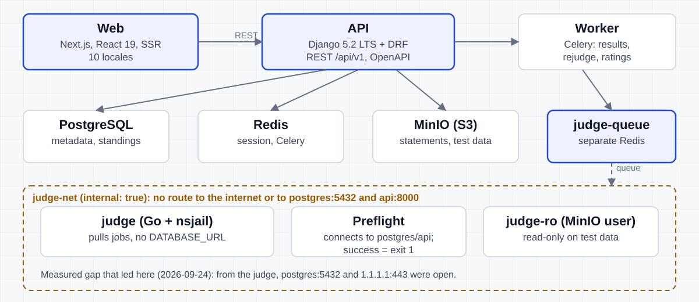

# RankWant: a competitive-programming platform for Uzbekistan

> Status: in development. Numbers below were measured on 2026-11-08 from the repository unless a date says otherwise.

| | |
|---|---|
| **Role** | Sole author and owner of all decisions |
| **Stack** | Django 5.2 LTS + DRF, Next.js (React 19, SSR), PostgreSQL, Redis, MinIO (S3), Celery, Go judge with nsjail, Docker Compose |
| **Scope** | Problems, contests, ratings, a judge that runs untrusted code, 10 interface languages |
| **Size** | 907 commits (874 mine, 33 from dependabot), 55 ADRs, 121 migrations, 6 workflows, 10 kinds of test folders |

<picture><source media="(prefers-color-scheme: dark)" srcset="../assets/rankwant-architecture-dark.svg"></picture>

*The diagram shows the deployed topology. The four-host layout is a planned step, not the current state (see "What is not done").*

## The problem

A judge executes code written by strangers. That is the most dangerous part of any online judge, and it is the part where a mistake becomes a host compromise. I needed an engine that supports 20 verdict codes, partial scoring and interactive problems, and I did not want to write a sandbox.

## Decisions

**1. Write the orchestrator, not the sandbox (ADR-0004).** Namespaces, seccomp and cgroups come from an existing tool. The reason is written in the ADR: the off-the-shelf judge I considered had three sandbox escapes to host root in 2024. The queue, compile, test, checker and verdict logic is mine.

**2. Choose the sandbox by measurement.** I built two judges against one contract, `JudgeProvider`: Go with nsjail and Python with isolate. Both ran the same 14 cases on the same host. Both passed (14/14 and 13/13). Python was faster on two cases. I chose Go for three reasons that are not speed: nsjail is Apache-2.0 and needs no setuid binary, and a Go binary deploys without an interpreter. The Python judge stays in the repository, inactive, because the contract covers both.

**3. Defects found by the bake-off were fixed in my code, not blamed on the tool.** Three implementation faults surfaced, for example an output limit that did not kill the process (2007 ms, fixed to 12 ms) and CPU limits that only counted whole seconds (2818 ms, fixed to 1333 ms with a cgroup `cpu.stat` watcher). The third was a silent break: compilation had been using the problem's run-time limit.

**4. Close the isolation gap with layers that fail closed (ADR-0028).** On 2026-09-24 I measured the live stack: from the judge container, `postgres:5432` and `1.1.1.1:443` were open. The earlier ADR had promised the opposite. The fix has four layers: an `internal: true` network for the judge, a separate queue Redis, a startup preflight that exits with code 1 if the judge can reach Postgres or the API, and a read-only MinIO user for the judge. The rule is checked by code, not only written in a document.

## A corrected assumption

The first version of ADR-0004 said the Python alternative needed cgroup v1 and a GRUB change with a reboot. That was wrong. The sandbox works on cgroup v2; the real problem was a default configuration that tried to delegate controllers from a cgroup that already had processes. I rewrote the ADR section as "Corrected assumption" and noted the consequence: there was no licence or operations reason left to rule the alternative out, so the decision had to stand on other criteria.

## Evidence

- Bake-off table and the three fixes: [ADR-0004](https://github.com/menarzullayev/rankwant/blob/main/docs/07-adr/0004-judge-engine.md), section "Bake-off natijasi" (the ADRs are written in Uzbek).
- Isolation measurement and the four layers: ADR-0028, dated 2026-09-24.
- Throughput measured on one host: 1 worker 2.4 submit/s, 8 workers 8.0 submit/s. Scaling is not linear because about 830 ms of each submission is compilation, which is CPU-bound.

## What is not done

- The judge still shares a host with Postgres, Redis and MinIO. ADR-0047 (separate judge host) is `deferred` to the next phase. The layers above reduce the blast radius; they do not replace a second machine.
- Removing `privileged: true` from the judge container is accepted (ADR-0046) but not yet measured. The ADR makes a 25-case bake-off a condition, and that gate has not passed.
- One host cannot reach the target of 500 submissions in 10 seconds. The plan is more judge hosts and a compilation cache.
- The platform is in development with demo data, not serving real contests.
