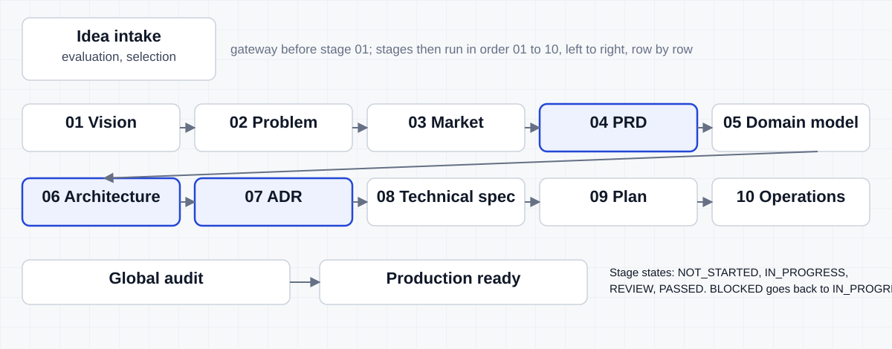

# Project Alpha: a documentation pipeline with checkable claims

> Status: framework version 1.0.0, public repository: [menarzullayev/project-alpha](https://github.com/menarzullayev/project-alpha). Facts measured on 2026-11-08.

| | |
|---|---|
| **Role** | Sole author |
| **Stack** | Python CLI (stdlib-first), JSON Schema, Markdown records, GitHub Actions |
| **Scope** | Take a selected product idea through ten documentation stages to a "production ready" gate |
| **Size** | 136 commits; test files for the CLI, records, schemas, recovery, semantics and an end-to-end run |

<picture><source media="(prefers-color-scheme: dark)" srcset="../assets/project-alpha-stages-dark.svg"></picture>

## The problem

When an AI agent writes product documentation, two things go wrong quietly. Stages drift apart (the architecture says one thing, the plan another), and claims such as "the market is large" appear with no source. I wanted a workflow where a person approves each stage and where a claim without evidence cannot pass.

## Decisions

**1. One source of truth, one derived file.** `project-state.md` is the human-readable truth. `.project-alpha/state.json` is derived from it and must never become a competing source. Decisions, approvals and handoffs are Markdown records, and every state change is also an immutable event.

**2. A small state machine instead of free-form status.** Each stage moves `NOT_STARTED → IN_PROGRESS → REVIEW → PASSED`; `BLOCKED` can only return to `IN_PROGRESS`. The CLI refuses other moves, so an agent cannot mark a stage done by editing text.

**3. Evidence is a record, not a sentence.** A material claim carries the claim, a source, a date, a confidence and a type. Risk decides how much evidence is required, so low-risk statements do not stall the work.

**4. Five validation layers.** Structural, schema, integrity, semantic, and an agent audit. The cheap deterministic layers run first and in CI; the agent audit only sees what they cannot decide.

**5. Completion has to be checkable.** The final audit lists milestones M1–M18, each with a repository artifact. A script, `scripts/audit_evidence_check.py`, runs in CI and fails the build if a row marked `VERIFIED` cites a path that does not exist. A closed GitHub issue is explicitly not accepted as evidence.

## Where it was used

RankWant's documentation tree (`docs/01-vision` to `docs/10-operations`, 55 ADRs) follows the same ten stages. That is one internal use. I do not have outside users of the framework.

## What is not done

- Used on a single real product so far. "Reusable across repositories" is a design goal tested on one repository plus clean-project bootstrap tests.
- The semantic layer checks structure and cross-references, not whether a market claim is true. A person still judges that.
- Versioning is explicit (`VERSION`, `MIGRATIONS.md`), but no migration between framework versions has been needed yet, so that path is untested on real data.
