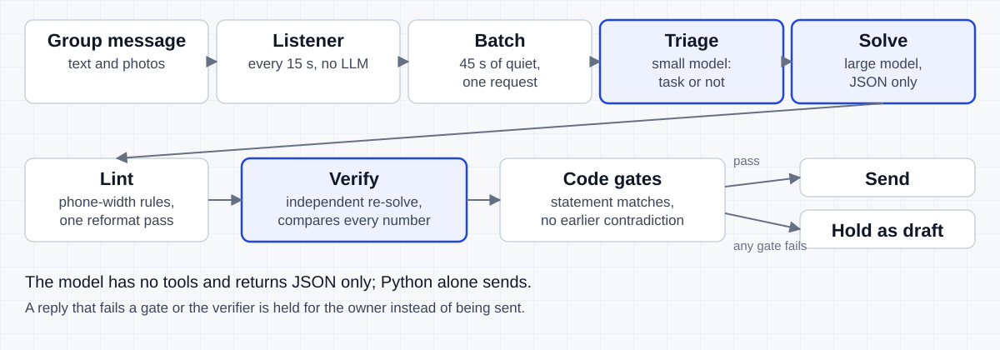

# tg-solver and the measurement of its verifier

> Status: personal experiment; the code is private. The measurement is public: [agent-verification-study](https://github.com/menarzullayev/agent-verification-study). Facts as of 2026-11-08.

| | |
|---|---|
| **Role** | Sole author |
| **Stack** | Python (asyncio), a Telegram user-account client, the `claude` CLI as the model runner, SQLite |
| **Scope** | Watch one group, decide which messages are tasks, solve them, and send a reply under my own name only when checks pass |
| **Size** | 70 commits; 354 offline tests across the project, 66 of them for the measurement harness |

<picture><source media="(prefers-color-scheme: dark)" srcset="../assets/tg-solver-pipeline-dark.svg"></picture>

## The problem

A tool that posts under my name must not post a wrong answer. A model can check its own work, but it can also be anchored by the answer it is shown. I wanted to know whether the verification stage actually catches errors, and whether showing it the reply makes it miss more.

## Decisions

**1. The model has no hands.** The model runs with tools disabled and returns JSON only. Plain Python decides whether to send. A test reads the harness source and fails if a forbidden token (anything that could send or write) appears.

**2. Gates outside the model.** A reply must pass formatting lint, an independent re-solve that compares every number, and code checks (the statement matches the task; no earlier contradiction). If any gate fails, the reply is held as a draft for me instead of being sent.

**3. Measure the verifier with injected errors.** I took real solved cases and corrupted them in four ways: a changed final answer, a changed statement, a wrong value in a step, and a wrong value carried consistently through steps and answer. Controls were left untouched.

**4. Fix the analysis rule before collecting data.** The rule was a paired exact McNemar test; the hypothesis needed a difference of at least 0.15 with p < 0.10, and the blind side had to pass a validity gate (at most 20% of controls flagged) or the comparison would be called not interpretable. The decisions are dated files in the repository.

## Result, stated with its limits

- The verifier that sees the reply caught **36 of 36** injected errors of the three kinds in run 1, with **0 of 24** false alarms on unmodified replies.
- The hypothesis "seeing the reply makes it miss more" was **not supported**.
- In run 2 the blind comparison **could not be interpreted**: the blind side flagged 3 of 12 controls, above the gate. One flag came from my comparator, two from variance of the blind model.
- 12 cases per cell, one model family on both sides, short numeric maths tasks, synthetic errors. Catching everything here is a ceiling effect, not proof that anchoring cannot happen.

## Where I was wrong

My first reading said the verifier missed 3 of 12 errors in intermediate steps. Reading the cases showed all three were problem-number headings, not computation. I wrote that as a dated addendum instead of rewriting the result, and I did not re-measure. Five pilots before the main runs each found a defect in my harness (missing chat context, proofs with no number to compare, numbering parsed as part of the task, a decimal cut as numbering, one error kind starving the others). Each got a test.

## What is not done

- Harder, realistic errors (for example a misread image shared by the solver and the checker) were not tested.
- Re-measuring step errors without heading numbers is an open decision, estimated at about 24 cases and under two dollars.
- The group, the people in it and the tasks are not part of this repository, by design.
