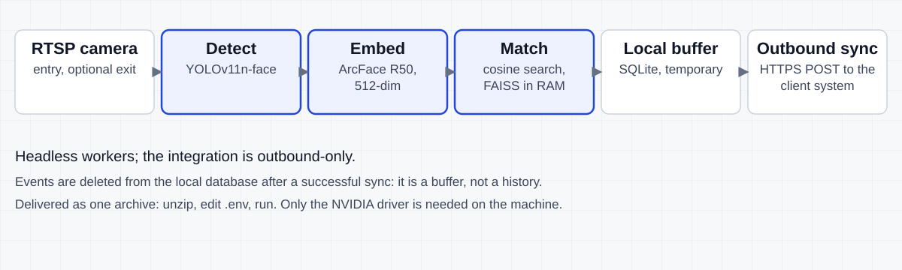

# A face-recognition attendance system for a state medical university

> Status: in production use at the client. The client is not named and no addresses, credentials or personal data appear here. Facts from the project's own documents, checked on 2026-11-08.

| | |
|---|---|
| **Role** | Built and delivered the system |
| **Stack** | Python, FastAPI, RTSP, ByteTrack, ArcFace (R50, 512-dim), YOLOv11n-face, FAISS, SQLite, NVIDIA GPU |
| **Scope** | Recognise staff at entry (and optionally exit) cameras and push each visit to the university's existing system |
| **Scale** | 2,376 enrolled people in the local smoke test; the plan assumes 2,000 to 10,000 |

<picture><source media="(prefers-color-scheme: dark)" srcset="../assets/attendance-pipeline-dark.svg"></picture>

## The problem

The university already had cameras and an attendance archive in its own web system. They needed recognition at the door, the visit pushed to their system, and nothing for their IT staff to maintain.

## Decisions: the story is mostly what I removed

The first architecture was ambitious: PostgreSQL with pgvector, Celery and Redis, a Django admin, a Next.js frontend, Nginx, Prometheus and Grafana, JWT roles, an audit log. The project documents record each removal as an ADR:

1. **PostgreSQL → SQLite + FAISS (ADR-015).** PostgreSQL was never installed; every pilot ran on SQLite. For 2 to 10 thousand people an in-memory FAISS index answered in under 5 ms in my smoke test, there is no database server to run, and operating cost is zero. The price: no horizontal scaling and a one-second index reload on restart. One machine is enough.
2. **Auth users and the audit log dropped (ADR-013, ADR-014).** The authentication stack had already been removed; the tables had no readers or writers, and the audit endpoint always returned an empty list. Bringing either back needs a new ADR.
3. **The service became headless.** No HTTP server, no frontend, no open ports. The dashboard lives in the university's system and the integration is outbound-only.
4. **The local database became a buffer.** After a visit is delivered, its event and outbox rows are deleted. Disk cannot fill up with history, and personal data does not accumulate on the edge machine.
5. **Camera-only from day one (ADR-002).** No QR or manual fallback was built first. The cost was stated in the ADR: it had to be production-ready immediately, so a shadow week and a manual-override path were required.

## Delivery

One archive: unzip, edit `.env`, run. The package brings its own CUDA 12.4 libraries; the machine needs only the NVIDIA driver. Entry and exit run as two processes with separate database files.

## What is not done

- Log rotation is missing, so logs grow on the server.
- Accuracy on real traffic is not published here. I measured detection and search latency, not false accepts in the field.
- Enrolling all 2,376 people took about 30 minutes in my test: acceptable once, not for frequent re-enrolment.
