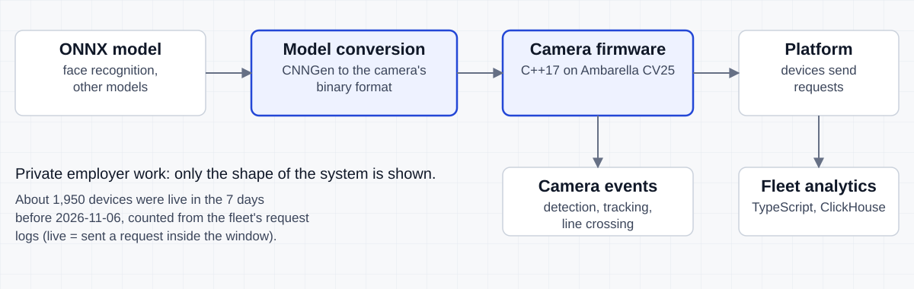

# Edge-AI firmware and model conversion for smart cameras

> Status: employer work at TassVision, private. No code, customer names, addresses or internal documents appear here, only what I am allowed to say about the shape of the work. The scale figure is approved for publication by me as the author. Written 2026-11-22.

| | |
|---|---|
| **Role** | Engineer in the firmware and AI models team since December 2025, after an internship (September to November 2025). I work with a colleague. |
| **Stack** | C++17, CMake, Ambarella CV25 (CNNGen toolchain), ONNX, TypeScript, ClickHouse |
| **Scope** | On-camera detection, tracking and line-crossing events; conversion of face-recognition models to the camera's binary format; fleet analytics |
| **Scale** | About 1,950 devices were live in the 7 days before 2026-11-06 |

<picture><source media="(prefers-color-scheme: dark)" srcset="../assets/tassvision-edge-ai-dark.svg"></picture>

## What the work is

Smart cameras run their models on the device. That moves three jobs to us: getting a model onto the camera's accelerator in the format it needs, writing the firmware that runs detection and tracking and turns them into events (for example a person crossing a line), and understanding from the other end how the whole fleet behaves.

- **Firmware.** C++17 for the Ambarella CV25: detection, tracking and line-crossing events.
- **Model conversion.** Face-recognition models start as ONNX files and are converted with the vendor toolchain (CNNGen) into the binary the camera loads.
- **Fleet analytics.** TypeScript tooling over the fleet's request data in ClickHouse, used to see how the fleet behaves, including how many devices are active.

## How the device count is made

The figure on this page is a count of devices that sent at least one request to the platform inside a window. It was taken on 2026-11-06 from the fleet's request logs: about 1,950 devices in the preceding 7 days. It says that many devices were reachable and talking. It does not say how many were doing useful work, how many customers there are, or how accurate the models were.

## What I do not publish

- Accuracy numbers for the models. I do not have field accuracy to publish, and a number measured on a different set of images would mislead.
- Customer names, store names, addresses or any footage.
- Internal tooling, repository names and the vendor's toolchain files (they are licensed, not mine).

## Decisions

### Run detection and tracking on the camera, keep fleet analysis on the server

- **Decision:** detection, tracking and line-crossing events run on the camera's accelerator. The server receives events and request data, and fleet analysis happens there.
- **Why (as I understand it):** two reasons. Latency and traffic: sending every video stream to a server costs bandwidth and adds delay, while an event is a few bytes. Cost at scale: with about 1,950 devices active in a week, running every stream through server-side models would need far more compute than the cameras' own accelerators, which are already paid for.
- **Whose decision and when:** inherited architecture. It was in place before I joined (internship started September 2025), so I did not make it. I work inside it and I know its reasons from the team, not from a design document I can cite.
- **Source:** my own account as the author. No public document backs it, and I have not measured the alternative (server-side inference), so the cost reasoning is not a number I can show.
- **What it costs:** every model must fit the camera's accelerator and be converted to its binary format, which is the model-conversion work above. A model that does not convert cleanly cannot ship.

## What is not done on this page

- Only one decision is listed so far. More will be added only when I can state each with a date and a source.
- The number above is a snapshot. The fleet changes daily; this page does not.
